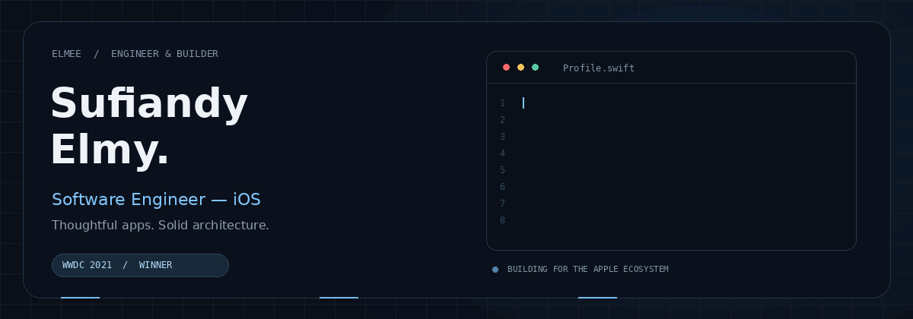

  

  
  &nbsp;
  
  &nbsp;
  
  &nbsp;
  

### About

iOS Engineer with **6 years** of experience. Building native apps with **Clean Architecture** and **AI-assisted workflows**.  
**WWDC ’21 Swift Student Challenge Winner** · Apple Developer Academy Alumnus

### Selected work

**Titipku** · **MyTelkomsel** · **Soothe Senses** · **SāatNya** · **Saldoo**  
Core contributor · Greenfield development · Modular architecture migrations

### Toolkit

  

SwiftUI &nbsp; / &nbsp; UIKit &nbsp; / &nbsp; Swift Concurrency &nbsp; / &nbsp; Combine

### AI & Agents

  
  
  
  
  

AI-assisted development · Agent workflows · Automation